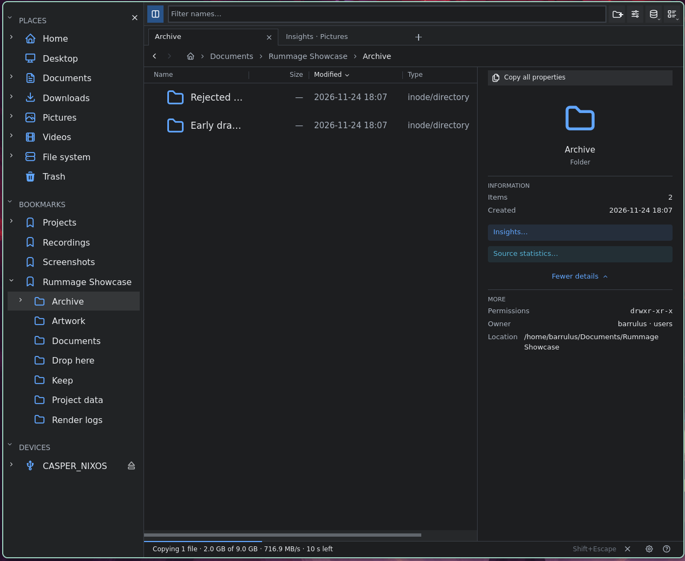

# File operations

[Documentation](README.md) · [Using rummage](usage.md) · [Actions and archives](actions.md)

File operations are available through shortcuts, context menus and the command
palette. Errors and progress appear in the status bar. Right-clicking an entry
selects it unless it is already part of the selection.

## Open files and terminals

Enter or a double-click opens files using desktop MIME associations. Open With
lists associated applications, default first, and can open the selection with a
chosen application. Several files for the same app can share one launch. An
executable file is opened by its associated application; selecting it does not
implicitly execute it.

Applications run independently of rummage. Terminal applications use `$TERMINAL`,
`xdg-terminal-exec`, or a discovered emulator. **F4** opens a terminal in the
folder under the cursor, otherwise the current folder. The context menu also
offers Open in Terminal. Launch failures appear in the status bar.

## Create and rename

**Ctrl+Shift+N** creates a folder with its name ready to edit. The background
context menu's **New File** creates an empty file or copies a template from your
XDG Templates directory. It does not overwrite an existing file.

**F2** renames one entry in place, initially selecting the name without its
extension. Enter or a click elsewhere accepts; Escape cancels. Text editing
supports compose input, word movement, selection, clipboard paste and local
undo/redo. Paste uses the first line of clipboard text. While editing a name,
Ctrl+Z edits that text rather than undoing a file operation.

When the clipboard contains an image or plain text, **Ctrl+V** creates a file in
the current folder. Images retain their offered format (PNG, JPEG, WebP, GIF,
TIFF, BMP, SVG or JPEG XL); plain text becomes a `.txt` file. Image data takes priority
over a text alternative. Clipboard file lists still copy or move the original
files as usual. Image signatures must match the offered format; this is a format
check, not a full decode or a guarantee that the image is undamaged. SVG accepts
a UTF-8 root element after optional XML declaration/comments within the first
4 KiB; SVGs with a DOCTYPE or a longer preamble are not accepted from raw clipboard
data. AVIF data is not offered as a paste format.

Data is limited to 64 MiB and written on a worker to a private staging file.
Only the completed file becomes visible under its final name. Errors or
cancellation remove the staging file; existing files and symlinks are never
replaced. New content files are readable/writable only by their owner and are
not executable.

The new file starts as `Pasted.png`, `Pasted.txt`, or the matching extension, with
a number added if the name is taken. Its base name is selected for immediate
renaming: type a name and press Enter. Escape keeps the generated name. Creation
participates in file-operation undo. Pasting while a filename or other text field
is being edited continues to insert text into that field.

## Move into a new folder

Select entries and choose **Move into New Folder…** from the context menu or
command palette. Enter a folder name to create it and move the selection into it;
darktable sidecars follow their images. Existing folder names are refused.

**Ctrl+Z** moves the entries back and removes the new folder only if it is still
the same folder and is empty. Files added later are preserved. **Ctrl+Shift+Z**
repeats the grouping. If the folder was replaced, the operation is refused.
This action is unavailable in Trash, archives and file pickers.

Hold **Alt** before entering the drop destination to choose **Copy Here**, **Move
Here**, **Link Here** or **Cancel**. Within the same window, dragging an entry with
the right mouse button opens the same menu; a right click still opens its context
menu on release. The menu names the destination and supports arrows, Enter and
Escape. Link Here creates absolute symbolic links, including in the source folder.
Internal drags also offer Move into New Folder; grouping works in the source folder.
Ordinary drops retain their usual copy/move behavior.

External drops offer Move only when the source advertises it. Operation-choice
drops negotiate a copy, then rummage performs the selected operation on the local
paths, so Cancel and Link leave the originals intact. Hold Alt before entering the
destination: an external drop already negotiated as a move must be retried. Wayland
does not expose the originating mouse button from other applications, and its drag
protocol has no link operation; use Alt and local file URIs for those link drops.

For a single supported archive, Alt-drop also offers **Extract into New Folder…**.
Choose a name to extract into a subfolder of the drop destination. If that name is
taken, a numbered name is used. The original archive stays in place. Extraction
uses the usual progress, conflict, cancellation and Undo controls. Drops from
another application negotiate a copy so extraction does not remove its source.

## Create symbolic links

Select files or folders and choose **Create Absolute Link**, **Create Relative
Link** or **Create Hard Link** in their context menu or the command palette.
Rummage creates `Link to <name>` beside each source, choosing a numbered name when
needed, and selects the new links. To choose another destination, copy the sources,
open that folder, and use its background menu's **Paste as Links** submenu or the
palette's **Paste Absolute Links**, **Paste Relative Links** or **Paste Hard Links**.
Multiple sources are supported. A cut clipboard also creates links without moving
or clearing the sources. Destination name conflicts use the usual conflict dialog.

Absolute symbolic links store the source path and can be moved independently.
Relative symbolic links store a path from their actual destination folder, including
when that folder is reached through another link. They can move with their shared
parent tree; moving either end independently can break them. Links to folders are
not copied or scanned recursively. Hard links are another name for the same file:
editing either changes the shared data. Only regular files on the same filesystem
are accepted; folders, symbolic links and cross-filesystem requests report an error.
The filesystem can impose additional restrictions, which are shown as errors.

**Ctrl+Z** trashes the new links without changing their targets; **Ctrl+Shift+Z**
restores the links. This action is unavailable in Trash, archives and file pickers.

For one symbolic link, **Go to Link Target** in its context menu or the command
palette selects the target in its parent folder. This follows one link step, so a
chained target remains selected as a link. Missing or inaccessible targets produce
an error without changing location. Resolution runs in the background; navigating
away cancels its pending navigation. Virtual Trash and archive entries do not offer
this action.

## Batch rename

Select several entries and press **F2**, or choose **Batch Rename…** in the context
menu or command palette. The dialog previews old and new names as you type.
Choose **Target: Basename**, **Extension** (without its dot), or **Whole name**.
The dialog applies Find/Replace first, then the character edit, then case conversion,
then the template. Folder names and leading-dot names such as `.profile` have no
extension. Extension-only edits leave directory names unchanged. Removing an
extension also removes its delimiter dot.

**Find: Literal** performs case-sensitive literal replacement. Switch to **Find: Regex**
for [RE2 expressions](https://github.com/google/re2/wiki/Syntax). For example, find
`^IMG_([0-9]+)$` and replace with `Photo-\1` to turn `IMG_123.JPG` into `Photo-123.JPG`.
`\0` inserts the whole match, `\1`–`\9` insert capture groups, and `\\` inserts a
backslash. Inline `(?i)` enables case-insensitive matching. An empty Find disables
replacement. Invalid patterns or capture references disable Rename; lookaround and
pattern backreferences are unsupported. Regex compilation is bounded and matching
does not backtrack.

**Position (from 0)** and **Remove characters** choose a range in the selected
target; **Insert text** replaces that range. Position 0 inserts at the beginning;
a position beyond the end appends. For `aé😀z.txt`, position 1, removal 2 and insertion
`新` produces `a新z.txt`. Positions count Unicode scalar values, not bytes or grapheme
clusters: combining marks are separate positions. Invalid UTF-8 bytes count as one
position each and otherwise remain unchanged.

The **Case** control offers unchanged, lower, upper and title case for ASCII letters.
Non-ASCII characters are preserved, and no normalization is performed. For example,
lowercase on the basename turns `PHOTO.JPG` into `photo.JPG`; on the whole name it
produces `photo.jpg`. Title case capitalizes ASCII words separated by punctuation
or spaces.

| Template token | Value |
| --- | --- |
| `{name}` | Transformed basename |
| `{ext}` | Transformed extension including its dot |
| `{n}` | Sequence number with the chosen padding |
| `{date}`, `{time}` | UTC date (`YYYY-MM-DD`) and time (`HH-MM-SS`) when the dialog opened |
| `{mtime}`, `{mtime_time}` | File's modification date and time in the same UTC formats |
| `{size}` | Regular file's byte size |

Metadata is a snapshot taken while preparing the preview. Missing requested metadata
disables Rename, rather than inserting an empty value; `{size}` is unavailable for
directories and symlinks. These are filesystem metadata tokens, not EXIF, media tags
or darktable-sidecar metadata. The date/time used for the batch stays fixed while
editing the preview.
For example, `bug-report_{n}{ext}` with start 1 and padding 2 produces
`bug-report_01.png`, `bug-report_02.png`, and so on. Numbering follows the current
view order; sort before opening the dialog. Step must be positive. Names must fit
within 255 bytes, and replacement/insertion fields within 255 bytes each.

Recognized darktable sidecars follow their photo, including duplicate sidecars.
Selecting them together with the photo does not consume extra numbers. The
preview includes their destination names. Invalid names, duplicate targets and
names occupied by unrelated entries disable Rename. Changes are checked again
when applied; files replaced since the preview are refused.

Tab moves through the fields, transformation controls, preview and buttons.
Space or Enter cycles a transformation control; Left/Right cycle backwards/forwards.
Enter elsewhere applies, Escape cancels,
and Page Up/Down or the wheel scrolls the preview. **Ctrl+Z** undoes the entire
batch, including its sidecars; **Ctrl+Shift+Z** redoes it. Swaps and chains use a
private temporary directory, and no step overwrites an existing entry. A failure
rolls back completed moves. If another process prevents rollback, a persistent
error dialog lists the remaining files and their recovery paths. Filesystems
without atomic no-replace rename support refuse the operation. Batch rename is
unavailable in Trash, archives and file pickers.

## Copy, move and conflicts

**Ctrl+C / Ctrl+X** copies/cuts the selection; **Ctrl+V** pastes into the current
folder. Cut entries fade until pasted or cancelled with Escape. File-manager
clipboard formats allow exchange with other desktop applications; only local
file paths/URIs are accepted for transfers.

Transfers run outside the UI thread, with progress and a stop button.
**View → Verify copied contents**, or **Enable Copy Verification** in the command
palette, enables verification for subsequent copies and moves in this window.
It defaults to off, is not saved across restarts, and each queued transfer keeps
the setting it was submitted with.

For regular files, including nested files and sidecars, verification flushes the
staged destination and rereads both files in bounded chunks for a byte-for-byte
comparison. This compares the contents directly rather than comparing checksum
digests. Copy and verification byte counts are shown separately; parallel files
can be copying and verifying at the same time. Verification adds two reads of the
data and a flush, which can be expensive on slow or network storage.

A failed or cancelled comparison does not publish that file or replace an existing
destination. Cross-filesystem moves retain unverified source files. Source identity,
size and modification/change timestamps are checked, including before deletion;
an externally changed source is reported instead of claiming success. As with other
partial transfers, successfully completed files may remain at the destination.
This is a consistency check through the operating system, not a guarantee against
future media failure or changes made after the check.

Same-filesystem moves remain renames and do not reread data. Symlinks copy their
link target without following it; their referent contents are not verified.
Archive extraction does not support this option and reports that limitation until
verification is disabled. With verification off, existing transfer behavior is unchanged.

**Shift+Escape** stops the active transfer from a file view or Quick Look; the
command palette also offers **Stop the Transfer** while work is pending. The
`stop_transfer` binding can be changed in Settings or `config.toml`.

Copies use temporary names before publishing completed output. Files can copy
in parallel through a bounded queue, while conflict questions remain on the UI
thread. A cross-filesystem move removes its source only after its copy is flushed
and published. Dates, permissions and symbolic links are preserved, and supported
darktable sidecars travel with the photo.
Moving a folder into itself or copying more than the available space is refused.

When a destination name exists:

| Choice | Result |
| --- | --- |
| Replace | Replace a file after its new contents are complete |
| Merge | Join two folders, asking separately about conflicting files inside |
| Skip | Keep the destination and omit that source |
| Keep both | Give the incoming item a numbered sibling name |
| Apply to the rest | Reuse the selected policy; a folder-merge choice never authorizes replacing files |

Nested folders join as part of the requested merge. Existing files inside them
are still subject to file-conflict choices.

Pasting into the source folder automatically keeps both. Cancellation stops work;
items already completed can remain. Temporary handling does not make a multi-file
operation one atomic transaction. Check the status message for partial failures.

## Drag and drop

Drag an entry by its icon or name. A selected entry drags its selection. Targets
include folders in each view, view background, breadcrumb segments and sidebar
places; dropping onto Trash trashes the files.

Within rummage, the default is move on the same filesystem and copy across
filesystems. Ctrl requests copy; Shift requests move. It uses the transfer engine,
including conflict handling, sidecars, progress and undo. Dropping into the same
location has no effect; a folder cannot be dropped inside itself.

External drops into rummage copy local files. Images and plain text can also be
dropped into ordinary folders, using the same validation, limits, atomic creation
and undo as paste. File offers take priority, then supported image data, one
HTTP(S) web address, and plain text. Invalid image data is rejected without
silently saving its text alternative. Created files use `Dropped` plus the
appropriate extension, adding a number on conflicts. They are selected when the
destination is still the current folder.

A dropped web address becomes a non-executable `Dropped.url` Internet Shortcut.
Its URL is stored without fetching it. Opening uses the desktop's association for
`.url` files; if no handler is installed, use Open With or read/copy the address
with a text editor. Other URI schemes, multiple URLs and injected control lines
are rejected. Raw content cannot be dropped into Trash, archives or the bookmarks
insertion area.

Drops out of rummage offer file URIs
and paths for copying; rummage does not delete its source because another program
claims it moved it. Web URLs are not local files. Dragging near a view's edge
scrolls; hovering does not automatically open a folder.

## Trash and restore

Disk-trash metadata must name a relative path within its source volume; absolute
paths, parent traversal (including URL-escaped `..`) and NUL bytes are rejected.
Invalid entries are excluded from the combined Trash view and cannot be restored;
their data stays in the volume's trash for manual recovery or Empty Trash.
Home-trash absolute paths and valid relative paths remain supported.

Before making missing destination folders, Restore checks the nearest existing
parent's filesystem, following symlinks. A destination on another filesystem is
refused without creating those folders, and disk-trash parent symlinks cannot
redirect restoration outside the volume's root.

**Delete** moves files to freedesktop Trash. Files on the home filesystem use the
home trash; other filesystems use their own trash where permitted. If a trash
cannot be created, the files remain and rummage reports why; it does not silently
replace trashing with permanent deletion.

The sidebar's **Trash** combines entries across the discovered trash locations.
It shows original names, original paths and deletion dates, with previews. Files
cannot be opened, created, renamed or pasted there.

Right-click **Restore** to return an entry to its original path, recreating missing
parent directories and asking about name conflicts. Restore does not merge a
conflicting directory. Supported trashed sidecars return with their photo.

## Transfer tasks

Open **View → Transfers…**, or search for **Transfers** in **Ctrl+K**, to see this
window's queued, running, waiting, paused, completed, failed and cancelled file
operations. Type to search by operation, state, name or source/destination path.
Select a task for progress, paths, errors and controls. **Copy Task Details** copies
the displayed details in full, including paths that are shortened on screen.

**Cancel Task** stops only that job. Cancelling a queued job leaves its files
untouched and does not dismiss another job's conflict question. Cancelling a running
job keeps work already completed; the usual partial-result and undo rules apply.
Answer an open conflict dialog before returning to the task list, or cancel that
operation from its dialog.

**Pause Task** and **Resume Task** apply to ordinary filesystem copies and moves,
including copy verification. Pause takes effect at the next data-chunk or item
checkpoint; a filesystem call already in progress may finish first. A same-filesystem
rename may finish before pause takes effect. Archive extraction, compression,
trash/restore, deletion, links and grouping do not support pause; their task details
say so. A queued archive source discovered by the worker loses its pause control
when extraction starts.

Jobs run in submission order. A paused queued job holds up later jobs until it is
resumed or cancelled. There is no reordering or automatic retry: after a failure,
inspect the partial results and submit a fresh operation for the remaining items.
Existing conflict choices still apply, and completed reversible work remains
available through Undo. External commands and batch renames use their own progress
and are not listed here.

History belongs to the current window and is not saved across restarts. The latest
100 finished tasks are retained alongside all pending tasks. Each task shows up to
64 names and 64 error messages, with counts for omitted entries. **Clear Finished
Tasks** removes finished records from this list without clearing Undo or affecting
pending work.

## Permanent deletion

**Shift+Delete** permanently deletes from a normal folder. **Delete** in Trash
also means permanent deletion. **Empty Trash** is available from its background
or sidebar menu and covers the discovered trash locations.

These actions ask for confirmation. Folder contents are counted for the size and
progress display. Deletion runs in the background and can be stopped, but files
already deleted are gone. Symbolic links are deleted without following them.
Permanent deletion cannot be undone.

## Undo and redo

**Ctrl+Z** undoes the last supported operation; **Ctrl+Shift+Z** redoes it.

| Operation | Undo behavior |
| --- | --- |
| Rename | Restore the previous name, including associated sidecars |
| Move | Move back, including across filesystems |
| Trash | Restore |
| Restore | Trash again |
| Copy | Trash the copies |
| Create symbolic or hard links | Trash the new names, leaving their targets untouched |
| Create folder/file | Trash it only if still empty/unchanged as appropriate |
| Permanent delete | Cannot undo |
| External action or archive extraction | Not recorded in file-operation undo |

Undo is session history, not a backup system. Changes made meanwhile can prevent
an inverse operation; rummage skips affected items and explains the result.
After a folder merge, undo affects only items newly placed by that transfer and
leaves pre-existing destination files in place. Undoing a merged move recreates
an emptied source folder when needed. Replaced files cannot be restored. A photo
with pre-existing destination sidecars is also excluded from undo so those
sidecars remain safe. Undo reports how many items cannot be safely undone and
leaves those items in place.

## darktable sidecars

Recognized darktable `.xmp` sidecars follow their photo through rename, copy, move,
trash and restore, including conflict-generated names. This is file handling,
not a darktable database integration. The current photo reader does **not** import
darktable star ratings; older documents described behavior removed in 0.4.0.

For compression, extraction, image conversion and other external tools, see
[actions and context menus](actions.md). External commands own their output and
overwrite behavior; they do not inherit the built-in transfer engine's guarantees.

## Executable files

For programs and scripts, **Allow Running as Program** adds owner execute permission;
**Stop Running as Program** removes execute permissions. These changes support Undo/Redo.
A small icon badge and “Runs as program” in the information pane indicate executable types
with permission. Direct opening runs ELF programs/AppImages, not scripts or documents renamed
to look like executables; a filesystem mounted `noexec` reports why running is unavailable.

## Choosing applications

**Open With → Choose another application…** in the context menu, or **Open With…**
in the command palette, lists installed, launchable applications,
including applications without an existing association for the selected type. Choose
an application, then **Open once** or **Set as default and open**. Mixed-type selections
can be opened once; setting a default requires files of one known MIME type.
Applications receive the selection through the normal desktop-entry argument and
terminal-launch handling. A missing application or early launch failure is reported.

Defaults are saved in your user `mimeapps.list`; unrelated types and comments are
preserved. Existing current-desktop overrides for the selected type are updated too.
The associated-applications context submenu reflects the choice on its next opening.
Read-only configuration and concurrent edits detected during saving are reported.
If saving several override files partially fails, retry after correcting the error;
successfully written associations remain saved. No system-wide MIME files are changed.

## Permissions and ownership

Open **Properties** and edit permissions, then choose **Apply**; **Cancel** discards the draft.
Symbolic links and read-only archive members do not offer permission edits.

Properties accepts multiple selected files and folders. Mixed read/write/execute bits are shown
as mixed; only bits you edit apply to every selected item. Owner and group accept an account name
or numeric ID; empty fields leave them unchanged. Changes use your existing privileges and report
permission failures. For folders, read lists names, write changes contents, and execute permits
entering/searching the folder.

“Include folder contents” defaults to no. Enabling it applies the same edited fields recursively,
without following symlinks or crossing filesystems, with bounded traversal. Special mode bits are
retained unless the kernel clears them after an ownership change. Partial successes remain applied;
errors name failed items. Retry retains your draft and refreshes successfully validated targets;
externally changed or replaced targets require reopening Properties. Permission/ownership edits
are immediate filesystem metadata changes and are not part of file-operation Undo.

## Tags, ratings and comments

Properties edits comma-separated tags, a rating from 0 to 5, and a comment. Multiple selections
keep mixed fields unchanged until edited. Empty edits remove the corresponding value. The info
pane displays saved annotations. Search accepts `tag:travel`, `rating:4`, and `comment:trip`;
tags match whole comma-separated labels, comments match substrings, and `case:fold` ignores ASCII
case. A missing rating matches `rating:0`.

Annotations live on the file or folder inode in `user.xdg.tags`, `user.rummage.rating`, and
`user.xdg.comment` extended attributes. Each value is limited to 4096 bytes. Rummage does not
modify photo sidecars or embedded media metadata. Filesystems without user attributes show a
clear unavailable/error state rather than storing invisible alternate copies. Read-only files
and locations remain readable where permitted; saving reports the filesystem permission error. External tools can
read/write the same attributes; reopen Properties or refresh search to see external changes.
Selected fields changed externally are rejected when saving a stale dialog.

Renames, same-filesystem moves, trash and restore keep inode attributes. Rummage copies these
three attributes with files and directories, including moves implemented by copy-and-delete;
if an annotated destination cannot store them, the copy fails and the original is retained.
Hard links share annotations. External copy/archive tools may discard extended attributes.

The optional Details “File rating” column displays and sorts general ratings. Zero is unrated;
a dash means unavailable or malformed storage. Ratings are read on directory workers and refreshed
with filesystem attribute changes. This sort is independent of photo star ratings in sidecars.

## Archive members and executable trust

Drag archive members to an ordinary folder, another pane or another Rummage window
to extract them. These drags always copy, including when Shift is held. They use
the same extraction queue, progress, cancellation and existing-name handling as
copy-to-extract. Read-only, unsupported or encrypted members keep the existing
extraction errors; member extraction does not decrypt password-protected entries.
Use whole-archive extraction for the external backend password dialog. Once a
window has received the drag data, closing the source window does not affect its
job. A drag interrupted before delivery creates nothing. No temporary extraction
is created for dragging. External applications do not receive archive-member drags;
extract to a real folder first. Choose **Open in New Window** on a supported archive
or an archive subfolder for a separate non-modal browser. The original panes and
archive file are unchanged.

Completed built-in and tracked command-line extractions mark regular files with bounded `user.rummage.archive-origin` provenance,
using the archive's download-origin URL when available. Rummage asks **Allow and
Run** before directly starting an archive-origin executable even when its execute
bits were stored in the archive. Approval pins the selected inode through launch
and clears only that file's marker; it does not trust the archive or its siblings.
Rummage copies propagate the marker and moves retain it. If provenance cannot be
written (including filesystems without user xattrs), extraction/copy removes all
execute bits after restoring metadata. A failure to enforce either policy prevents
publication. The check is Rummage's opener policy, not a system-wide execution
sandbox: terminal commands, other file managers and deliberate chmod/xattr changes
are outside it. File Roller and custom external extraction actions own their output and
are outside this provenance policy. Scripts continue to open as documents rather than run automatically.

### Remote filesystem limits

A copied **verified move** is refused before staging when a FUSE/NFS/SMB source
exposes only whole-second modification and change timestamps. Such metadata
cannot reveal a same-size write made after comparison; use Copy, review the
source and destination, and delete explicitly when appropriate. Ordinary verified
copies and atomic same-filesystem moves retain their usual behavior. No
verification can promise a snapshot while another writer modifies a file.

Where `RENAME_NOREPLACE` is unavailable, archive creation and individual extracted
regular files can publish with an atomic no-overwrite hard link. If the backend
also lacks hard links, the operation fails without replacing existing data.
Extracted directory publication and grouping into a new folder require atomic
no-overwrite directory rename and report the limitation where it is absent.
Create a folder and move files explicitly as an alternative to grouping.
