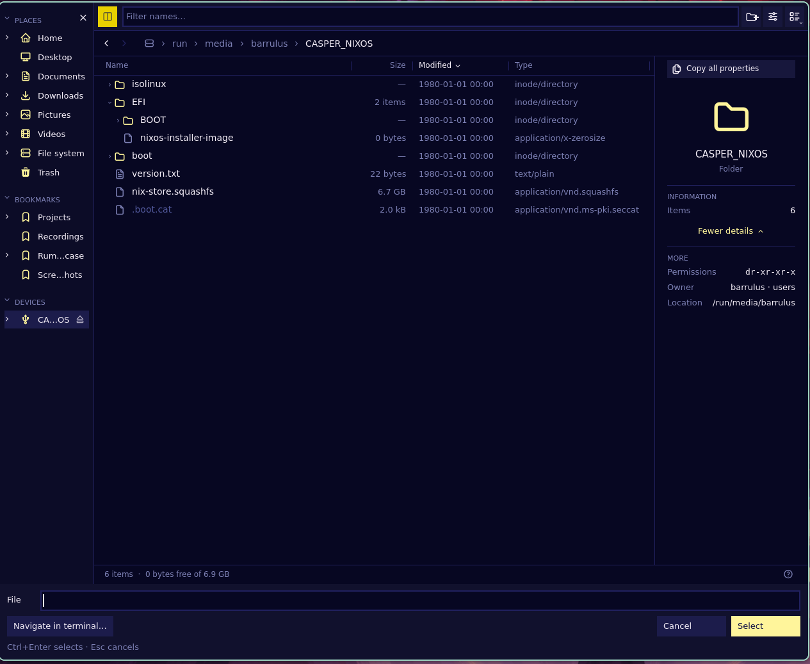

# File picker

[Documentation](README.md) · [Installation](install.md) · [Command line](command-line.md) · [Troubleshooting](troubleshooting.md#applications-do-not-use-the-picker)

This guide describes rummage's picker and portal integration. It is separate from
the default application used to open folders.

Jump to [NixOS setup](#enable-on-nixos-with-umbriel), [other systems](#enable-on-other-systems),
[standalone usage](#try-without-changing-desktop-defaults), or [verification](#verification).

rummage can provide Open, Save and folder-selection dialogs for applications using the
XDG FileChooser portal. Its backend runs alongside other portal backends: Umbriel can keep
handling screenshots and screen sharing, with rummage handling file selection.

The picker supports single and multiple files or folders, SaveFile and SaveFiles, initial
folders and filenames, glob and MIME filters, application-provided options, overwrite
confirmation and cancellation. It uses the usual rummage views, sidebar and previews.
Picker windows keep their own view, window size and last folder in
`$XDG_STATE_HOME/rummage/picker.toml` (normally `~/.local/state/rummage/picker.toml`).
They start in grid view the first time and never restore or overwrite your
file-manager tabs and window state. An application's requested folder takes
precedence over the picker's remembered folder.

## Enable on NixOS with Umbriel



Add rummage to your system flake's inputs (use this checkout's path while developing):

```nix
inputs.rummage.url = "path:/absolute/path/to/rummage-fm";
```

Import its NixOS module and enable the application and picker. In a NixOS module where
`inputs.rummage` refers to this flake (pass `inputs` through `specialArgs`):

```nix
{ inputs, ... }: {
  imports = [ inputs.rummage.nixosModules.default ];

  programs.rummage = {
    enable = true;
    filePicker.enable = true;
  };
}
```

This installs rummage, enables the portal frontend, registers rummage's backend and selects
it for FileChooser requests in Umbriel. D-Bus starts `rummage --portal` on demand; there is
no separate picker package or service to enable. The backend exits after 30 seconds
without an active request and is activated again when needed. Enabling only `programs.rummage.enable`
installs the file manager without changing portal preferences. `programs.rummage.package`
can override the package used for both the application and backend.
Video and PDF previews are included in the standard package for both. Use the
application’s General settings to toggle them.
Both preview settings default to `true`; image thumbnails are also built in.

Keep your existing Umbriel and GTK portal packages and
`xdg.portal.config.umbriel.default = [ "umbriel" "gtk" ];`: the module merges its package
and FileChooser preference into those settings. Remove any previous FileChooser preference
for a different backend in that desktop's configuration.

For another desktop, set `programs.rummage.filePicker.desktops = [ "niri" ];` (using the
lowercase name from `XDG_CURRENT_DESKTOP`), or list several desktops. Use `[ "common" ]`
for the desktop-independent `portals.conf`. Keep the other backend preferences in
`xdg.portal.config.<desktop>`: a desktop-specific file takes precedence over common or
package-provided configurations, so copy their other preferences if necessary.

### Manual NixOS configuration

Without importing the module, the equivalent picker configuration is:

```nix
{ inputs, pkgs, ... }:
let
  rummage = inputs.rummage.packages.${pkgs.stdenv.hostPlatform.system}.default;
in {
  xdg.portal.enable = true;
  xdg.portal.extraPortals = [ rummage ];
  xdg.portal.config.umbriel."org.freedesktop.impl.portal.FileChooser" = [ "rummage" ];
}
```

Keep your existing Umbriel and GTK entries in `extraPortals`, and the existing
`xdg.portal.config.umbriel.default = [ "umbriel" "gtk" ];`. NixOS module lists merge;
if editing a single existing list, append rummage to it. The portal package includes rummage
itself, its D-Bus activation service and `rummage.portal`.

After rebuilding the NixOS configuration, log out and back in, or restart the frontend
when no portal dialog or screen-sharing session is active:

```sh
systemctl --user restart xdg-desktop-portal.service
```

## Enable on other systems

Configure the intended install prefix, build and install rummage:

```sh
cmake -B build -G Ninja -DCMAKE_INSTALL_PREFIX="$HOME/.local"
cmake --build build
cmake --install build
```

The install includes:

- `share/xdg-desktop-portal/portals/rummage.portal`
- `share/dbus-1/services/org.freedesktop.impl.portal.desktop.rummage.service`

Both the portal frontend and the session bus must discover that installation's `share`
directory. For a user install this is normally `~/.local/share`. On distributions which
restrict portal discovery to system packages, use their portal-package configuration instead
(the NixOS example above does this).

In `~/.config/xdg-desktop-portal/umbriel-portals.conf`, preserve your other preferences and add:

```ini
[preferred]
default=umbriel;gtk
org.freedesktop.impl.portal.FileChooser=rummage
```

For another desktop use its lowercase desktop name, or `portals.conf` for a common override.
Restart the frontend or log in again. Restart applications which cached their portal choice.
Only applications that use the file-chooser portal will use rummage; an application's own
built-in dialog remains its own.

## Try without changing desktop defaults

Run in a Wayland session:

```sh
./build/rummage --pick ~/Pictures
./build/rummage --pick --multiple ~/Pictures
./build/rummage --pick-directory ~
./build/rummage --save-file --name Untitled.txt ~/Documents
```

These commands return absolute paths, separated by NUL bytes, on stdout. Exit status is 0
on selection, 1 on cancellation, and 2 for invalid arguments. Runtime failures can also exit
nonzero. For a readable demonstration, pipe the output to `tr '\0' '\n'`; scripts should
preserve NUL separators because filenames may contain newlines. `--title TEXT` sets the title.
`--portal` runs the D-Bus backend; it is normally activated automatically.

Enter or double-click opens a folder or accepts a file. Use the bottom action button or
Ctrl+Enter to accept a selection, including the current folder when no child is selected.
Tab and Shift+Tab cycle through the browser, filename, filter, application options
and action controls. Application options appear directly as checkboxes or choice
buttons; Enter or Space activates a focused control. Long option lists wrap and
scroll, and keyboard navigation keeps the focused option visible.
Escape closes a preview/menu first, then cancels the picker. In Save dialogs,
typing replaces the selected filename stem while preserving its extension. Typing
an existing folder's name and accepting opens that folder; **New Folder** creates
a folder and lets you name it. Saving an existing file asks for confirmation;
the picker returns the destination and does not write the application's data.
Cancellation lets the picker save its UI settings, with forced termination after
three seconds if it does not close.

Wayland parent handles use xdg-foreign-v2, with modal hints when xdg-dialog-v1 is available.
A missing/unsupported parent handle (including an X11 parent) opens an independent window.
Glob filters ignore case (`*.jpg` also matches `PHOTO.JPG`). MIME filters accept
`*/*` for all files and follow subtype inheritance, including wildcard categories
such as `image/*`. MIME filtering uses rummage's directory-entry MIME classification and filename rules;
files whose type is only recognizable by inspecting their contents may require the
application's All Files filter.

## Verification

```sh
./build/tests/rummage-tests --test-case='picker:*'
dbus-run-session -- ./build/tests/rummage-portal-tests
./build/rummage-snapshot --columns ~/Documents --picker save /tmp/picker.ppm 960 640 1
```

The integration test runs on a private bus with a fake picker child. It checks the real backend's
OpenFile, SaveFile and SaveFiles responses, URI escaping, filters, application options,
concurrent requests, cancellation, malformed inputs and child failures. The UI tests exercise
real browser selection, view changes, filename validation and overwrite confirmation.

Protocol references: [FileChooser backend](https://flatpak.github.io/xdg-desktop-portal/docs/doc-org.freedesktop.impl.portal.FileChooser.html),
[Request cancellation](https://flatpak.github.io/xdg-desktop-portal/docs/doc-org.freedesktop.impl.portal.Request.html),
[portal preferences](https://flatpak.github.io/xdg-desktop-portal/docs/portals.conf.html).

## Filtering and creating folders

The toolbar includes a live **Filter** field and a **New Folder** button in column,
grid, and details views. The name filter matches substrings (ignoring ASCII case)
and combines with the application's file type restrictions. Ctrl+Shift+F focuses
it; Enter returns to browsing with the filter applied, and Escape clears it without
closing the picker. Clear removes the filter with a click. Ctrl+F still opens the
recursive file finder. The filter remains active when changing views or folders.

New Folder (also Ctrl+Shift+N) clears the name filter, creates a folder in the current
location, and selects its name for editing. When choosing a folder, the picker labels
the input **Folder**. Typing a nonexistent folder does not create it: the error points
to New Folder. Missing selections, broken links, wrong item types, and access errors
have distinct messages; changing the name or selection clears a previous error.

## Navigate in a terminal

Choose **Navigate in terminal…** to open a terminal in the picker's current local
folder. Navigate with `cd`, shell completion, or tools such as `zoxide`, then type
`exit` or press Ctrl+D. Rummage displays the final folder; select the file or folder
and confirm in the picker as usual. Returning a directory does not accept the
selection, change the picker mode, or remove its filters and application options.
Switching focus back to the picker alone does not update the folder.

The initial supported shells are **Bash, Zsh and Fish**, selected from `$SHELL` (or the
account's login shell when unset). Rummage starts an interactive, non-login shell
and loads its normal interactive configuration. Temporary exit hooks belong only
to this session; startup files are never edited. Zsh's `ZDOTDIR` is restored for
user configuration, and existing exit hooks remain in use. Fish loads its usual
`config.fish`, `conf.d` snippets and autoloaded functions before the temporary
`fish_exit` hook is installed. Session-local signal handling prevents hangups from
returning a directory, including when a user signal handler calls `exit`. Startup configurations
that replace the shell with `exec`, disable startup files, or replace the installed
exit hook can prevent a handoff; ordinary GUI navigation remains available.

The terminal uses the existing [terminal configuration](configuration.md#terminal-and-program-opening):
`[terminal]`, then `$TERMINAL`, `xdg-terminal-exec`, or a supported terminal on
`PATH`. The terminal must support running a supplied command. Its own default-shell
setting does not override `$SHELL` for this action. Other shells currently produce
an explanatory message without launching a session.

Closing the terminal window, a shell crash, or a failed launch does not choose a
folder. An inaccessible or removed returned folder produces an error and leaves
the current view usable. Each picker has its own private session; starting the
action again replaces that picker's previous session. Accepting, cancelling, or
closing the picker removes the session, and late returns are ignored even if the
terminal remains open. Only paths accessible in the picker's local filesystem
are supported; remote-shell and container path translation is not provided.

Shell integration follows the [Bash startup-file rules](https://www.gnu.org/software/bash/manual/html_node/Bash-Startup-Files.html)
[Zsh startup-file rules](https://zsh.sourceforge.io/Doc/Release/Files.html),
and [Fish initialization options](https://fishshell.com/docs/current/cmds/fish.html).
