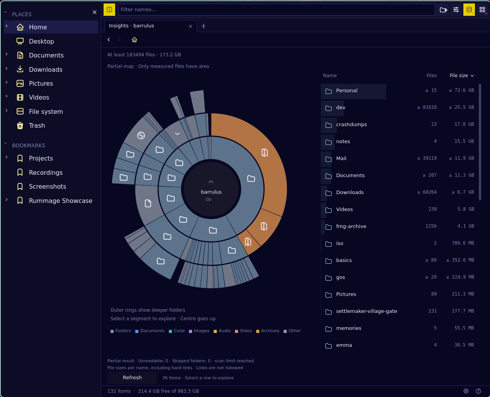
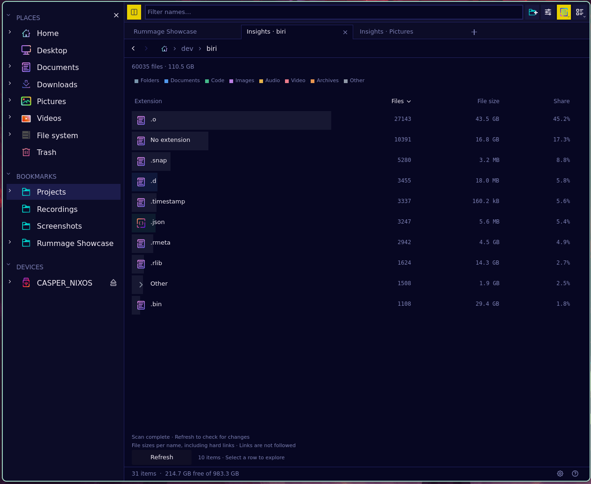
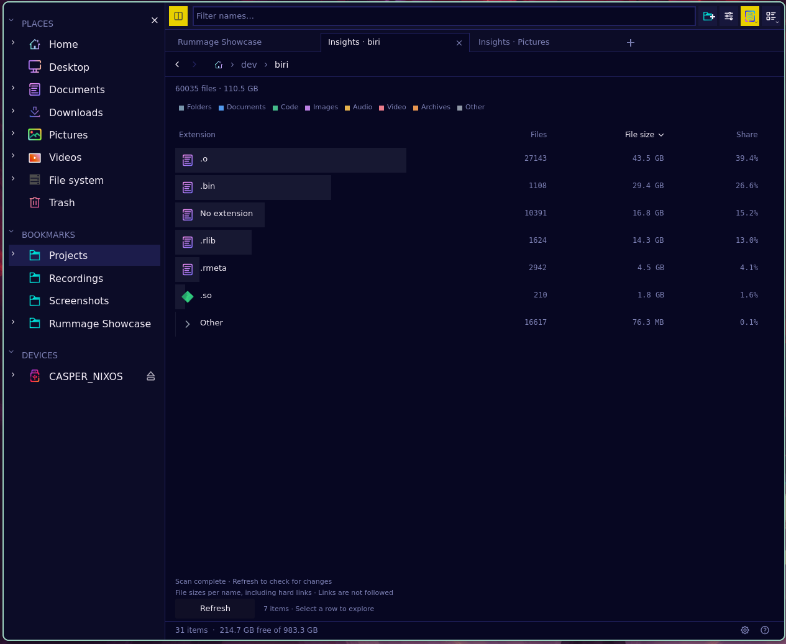
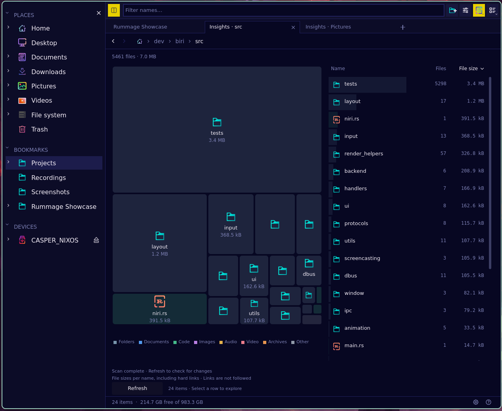
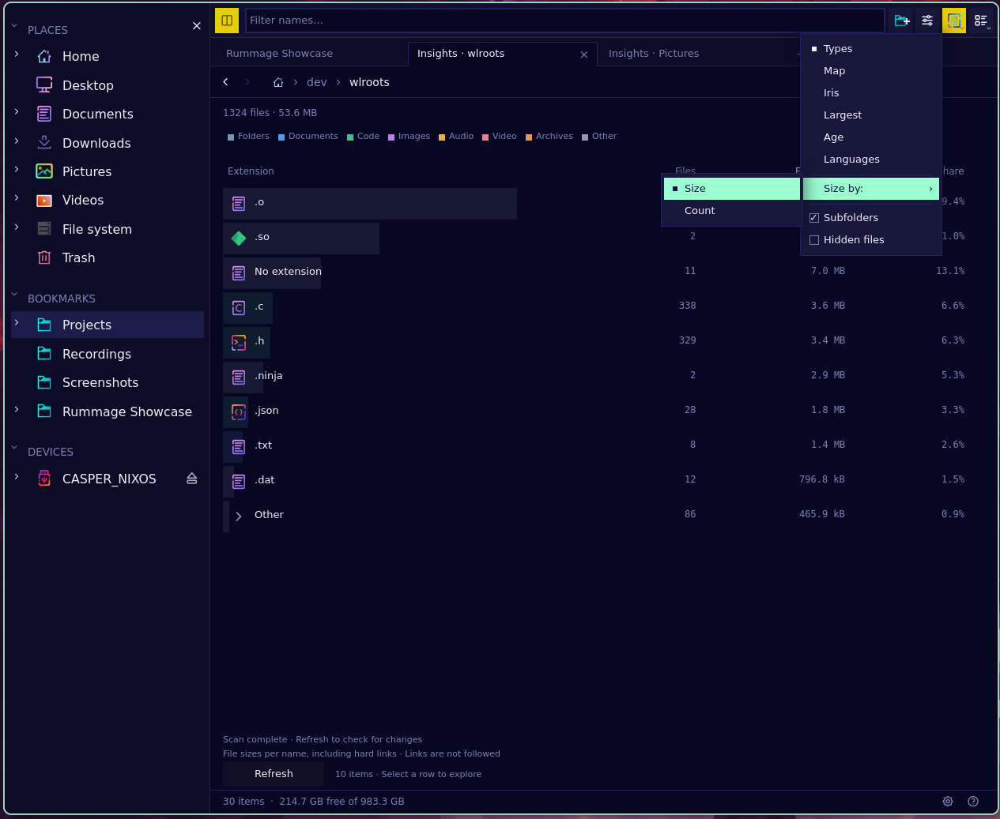

# Folder Insights

[Documentation](README.md) · [Using rummage](usage.md) · [Shortcuts](shortcuts.md)

See what a folder contains with file-type breakdowns, Iris rings, a Space map,
largest files, modification ages and source-language statistics.

## Open Insights

Use the **Insights** icon in the shared filter bar and choose a view,
press **Ctrl+Alt+I**, or choose **Insights…** from the
command palette or a folder's context menu, or use the information-pane button. A single selected
folder is inspected; otherwise the current folder is used. This view is available
for local folders in the browser, outside Trash, archives and file-picker mode.
Insights opens in a dedicated tab, leaving the original file-browsing tab and its
selection intact. Switch tabs to return to browsing; close the insights tab with
its × or Ctrl+W. Choosing a Place or bookmark while insights is active recentres
the graphs on that folder. The information/preview pane is hidden in insights,
leaving the full content width for graphs and file results.

## Views and navigation

The **Insights** icon opens a menu with **Types**, **Map**, **Iris**, **Largest**,
**Age** and **Languages**. While Insights is active, the menu also contains
**Size by: Size / Count** for applicable views and the **Subfolders** and
**Hidden files** toggles. Press the Insights shortcut again while an Insights tab
is active to open this menu with the keyboard. The choices are also searchable
in the command palette. These settings follow the active pane. Navigate with
the breadcrumb above the content; Insights has no separate location bar.
Numeric columns are right-aligned with fixed-width digits. Proportional row
fills make quantities comparable without relying on tiny underlines.

Map, Iris and file-type results use a consistent category palette and legend for
folders, documents, code, images, audio, video, archives and other files. Age uses
an ordered colour scale. Hover links chart segments and their rows in both
directions. Tiny map entries share a More tile; labels that cannot fit are hidden,
with the full name and amount shown in the chart's hover caption. The list remains
scrollable, with a total item count rather than page navigation.

- **Types** groups regular files by filename extension, ignoring ASCII case.
  PDF, DOC, DOCX and MD remain separate; common compound archive suffixes such as
  `.tar.gz` stay together. Extensionless files have their own row. This classifies
  names without reading file contents; it does not verify the actual format.
  With more than twelve types, the overview retains up to twelve leading types
  contributing at least 1% of the active measure and groups the remainder into
  **Other**. Select Other to browse all its types, then a type to see its files.
  No files or measured bytes are discarded by grouping.
- **Size by: Size / Count** changes ordering, proportions and treemap areas using
  the same scan. File size is selected initially. Click any table-column header to
  sort it; click again to reverse the direction. **Sort By** offers the same columns
  and ascending/descending options. Source columns include Files, Lines, Code,
  Comments and Blanks; embedded languages stay grouped with their parent. Sorting
  preserves the selected file. Wide type tables show percentages
  of the current scope (of the files counted so far when incomplete).
- **Subfolders** and **Hidden files** define the scan scope. Hidden files
  initially follow the browser's setting. Changing either option starts a new scan.
- Select a type to list its exact matches. Single-click a matching file to select
  it in place.
  Double-click or press Enter to open it; Space opens Quick Look. The normal context
  menu, copy/cut commands, drag-out and F2 inline rename act on that file without
  leaving insights. Ctrl/Shift selection and Ctrl+A operate on results in the
  selected file’s parent folder, as in the expandable details view.
  **Map** shows immediate children weighted by their total
  file count or size; select a folder to drill into it. The accompanying scrollable
  list also includes zero-sized entries and items too small to label on the map.
  Colored tiles represent folders; files use their file-type icons. Selecting a
  file selects it in place; double-click opens it. Icon sizes are capped for
  readability; use the size labels and list bars for exact comparisons.
- **Iris** is a sunburst inspired by [Luciole](https://github.com/Excelsies/luciole).
  The centre is the current folder and goes **Up** when clicked. Three rings show
  children, grandchildren and great-grandchildren: every child stays inside its
  parent's angular span. File branches end where the file appears. Size or count
  controls the angles; unmeasured folders and zero values get no invented area.
  Select a folder at any depth to drill in. Selecting a deeper file brings its
  containing folder and file selection into the same insights tab.
  The graph caps individual segments and combines tiny portions into **More**;
  selecting More brings the remaining entries into the scrollable list. Charts
  keep metric order when the list is sorted. Filtering selects the top-level
  branches and includes their descendants. The diagram is bounded to 256 segments;
  drill down to explore branches beyond its three displayed levels or segment budget.
  Navigation and measure changes animate with the app's motion and reduced-motion
  settings. Partial scans show only measured proportions.
- **Largest** ranks individual files across the scope by logical size, with
  proportional bars and relative paths. Select one to inspect it or use its normal
  file actions.
- **Age** groups file modification times into the last 24 hours, 1–7 days,
  7–30 days, 30–365 days, over a year, and future dates. These are elapsed periods
  relative to the scan time, not calendar dates. Switch between count and size;
  select a group to list its files.
- **Languages** reads source files with [Tokei](https://github.com/XAMPPRocky/tokei)
  and shows files, lines, code, comments and blanks, with a stacked composition
  graph. Embedded languages (such as Python in Markdown) appear indented under
  their parent; their lines are counted separately, while the overall file total
  counts physical source files once. Select a language to see its source files.
- **Back**, **Backspace**, or **Alt+Left** retraces your visits, including type matches.
  **Alt+Up** opens the parent folder. Click a breadcrumb to jump to an ancestor,
  or press **Alt+D** to edit the breadcrumb path and recentre Insights.
  **Tab**, **Shift+Tab**, arrows and **Enter** operate controls and file rows.
  The wheel, touchpad, scrollbar and **Page Up/Down** scroll results.
  **Escape** dismisses the menu or returns from matching files to their
  previous graph; it leaves the insights tab open.

Switching tabs preserves the open insight, selection, location, measurement,
scroll position and scan options. A newly opened insights tab starts at the
selected folder; hidden files initially follow the browser setting.

## Source statistics

Source analysis starts only when you open **Languages** or **Source statistics…**
from the information pane. The pane then shows the **Last source analysis** for
that folder. Refresh the analysis after edits; the summary is a snapshot, not live
indexing. Nix builds include Tokei. Other installations need `tokei` on `PATH`;
without it, the other insights views still work.

Tokei respects ignore files such as `.gitignore`, in addition to the subfolder and
hidden-file switches. Its source totals can therefore differ from the metadata
views. It uses its own traversal rules and can cross mounted subdirectories.
Analysis stops after 30 seconds (with a short termination grace period), and
reports over 16 MiB are rejected. Failed, stopped or oversized analyses display an
error rather than incomplete counts. Tokei may also report unreadable source files;
that condition is shown alongside the available counts.

## Totals and scan limits

File sizes are logical bytes summed **per filename**, including every hard-link
name. They are not allocated space on disk and can differ from the information
pane's deduplicated total. Symbolic links, including a linked scan root, are not
followed. Hidden files are included only when enabled; sockets, devices and pipes
never contribute to regular-file totals.

Metadata scans run on a worker, stay on one filesystem, and stop at 200,000 examined entries,
32 MiB of names, 64 directory levels or 30 seconds between filesystem calls.
Folders are discovered breadth-first, so a deep tree does not hide its siblings.
Unreadable or skipped folders and stopped/limited scans are explicitly partial.
The map shows measured files only; unmeasured folders remain in the list as
**Unknown**, rather than appearing to be empty. Select a partial folder to scan
that smaller scope with a fresh budget.
**Stop** retains the partial result; closing cancels outstanding work. Network and
FUSE roots are skipped, except local fuseblk disks. Charts are snapshots, not live
filesystem monitors: use **Refresh** after changes. Refreshing a nested scope keeps
Back available. The filename filter in the browser does not restrict these scans.

## Iris in action

Outer rings show deeper folders; select a folder segment to explore it and the
centre to go up. This capture shows a partial result after a scan limit was
reached. Only measured files have area; **At least** and **≥** indicate lower bounds.

## Types, Map and scope examples

These earlier development captures show the custom dark palette. Current builds
choose these views and scan options from the shared **Insights** menu described above.

| Types by count | Types by size |
| --- | --- |
|  |  |

