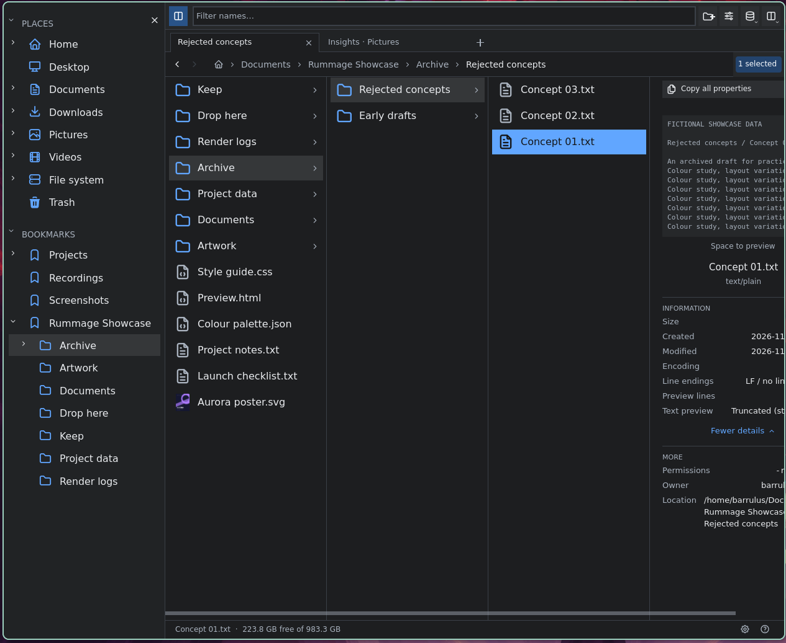
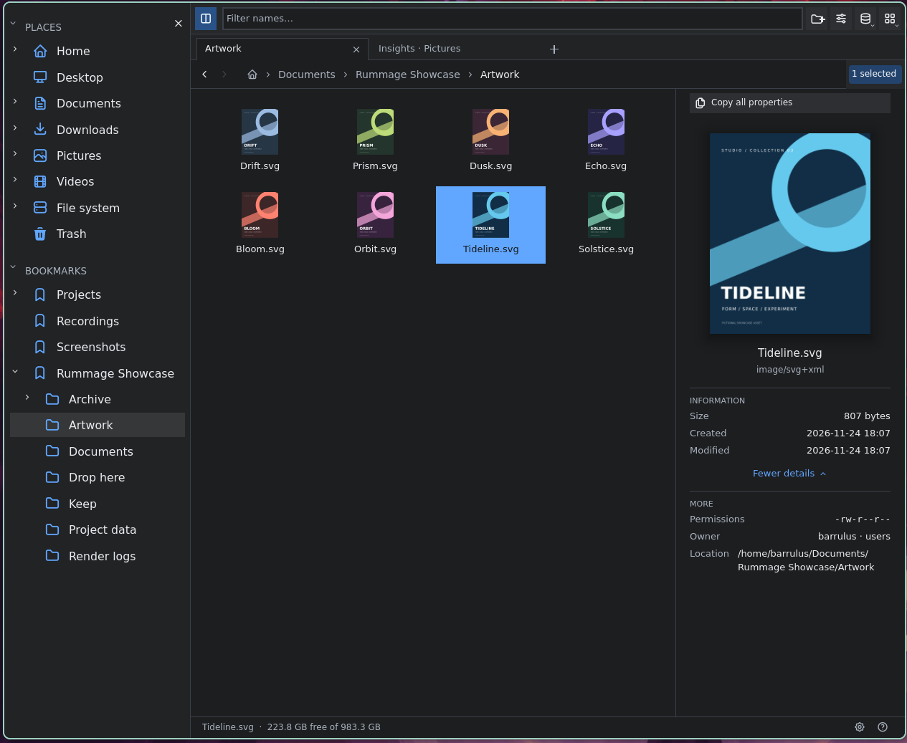
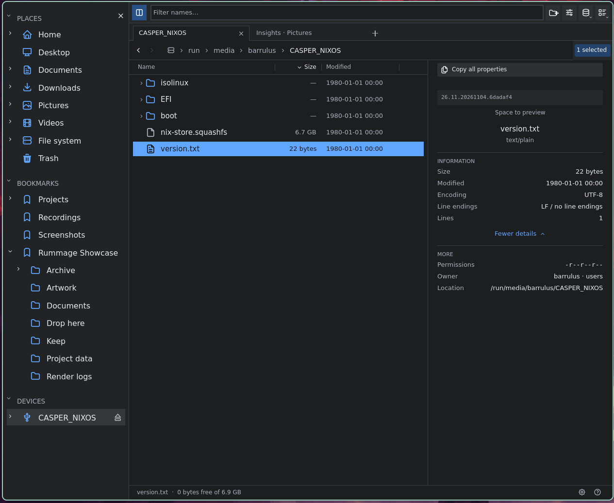

# Using rummage

[Documentation](README.md) · [File operations](file-operations.md) · [Shortcuts](shortcuts.md)

Start `rummage` in a Wayland session, or pass a directory such as
`rummage ~/Pictures`. **F1** shows the active keyboard bindings and **Ctrl+K** opens
the command palette. Both reflect configured actions and shortcuts.

Type a filename prefix in a file view to select the first visible match; the status
bar shows what you typed. Backspace edits the prefix, Escape clears it, and one
second of inactivity resets it. Settings → General also offers optional H/J/K/L
movement and navigation wrapping. See [keyboard browsing](shortcuts.md#browse-entirely-with-the-keyboard).

## Multiple windows

**Ctrl+N** or **Open in New Window** opens another browser in the same process.
Each window has its own tabs, panes, focus, navigation, selection and undo history.
Clipboard contents, thumbnails, mounted places and configuration are shared.
Copy/paste and drag/drop work between browser windows; right-button drags keep
the Copy/Move/Link choice when crossing windows. Launching rummage again normally
adds tabs to the most recently focused browser's active pane; use `--new-window`
to request another window. See [launch reuse](command-line.md#reusing-windows).

Closing a browser waits for its file operations to finish. Other windows remain
usable. **Ctrl+Q** closes only the window receiving the shortcut, waiting for its file
operations and any Settings save/discard decision. Other browser and Properties windows
remain open. Closing the last window exits. Signals still cancel the
application as before. Session state has one writer: it saves the most recently
focused browser's panes, tabs and size. Other windows are temporary and are not
all restored at the next start. Picker state is separate.

**Properties** opens an independent window for each selected item. Browsing stays
available, and each Properties window can remain open after its originating browser
closes. Metadata refreshes when the containing directory changes, provided there
are no staged edits; missing or deleted files show a read error. Applying changes
refreshes the affected entries in all browser windows. Settings also opens in a
separate window by default, with changes applied across the application.

## The window

The sidebar contains places, bookmarks, Trash and devices. The breadcrumb above the
files opens any parent in the current path. The status bar shows counts, selection,
free space, operation progress and messages, plus view buttons. The information
pane shows a preview and a compact metadata summary for the focused item; expand
More details for extended media fields, permissions, owner/group and links.
Copy all properties at the top includes collapsed fields.

Selecting several files keeps the focused file's preview and metadata visible.
Each pane shows its selected-item count at the upper right of its breadcrumb header,
even when the preview is hidden. **Ctrl+arrows** moves focus without changing the
selected set; **Ctrl+Space** toggles the focused item. A focus outline distinguishes
the inspected item from selected items. The **Selection** section below the file's
information retains combined file/folder counts and size.

Right-click a place or bookmark to open that location, open it in a new tab or
in the other pane, copy its path, or view Properties. Open in Terminal appears when
a terminal is configured. Bookmark rename, reorder and removal commands remain in
the same menu. Unmounted devices offer mounting first; path actions become available
after mounting.

Keyboard browsing highlights the focused Places row or outlines the active file
area. **Shift+F6** returns to the file list. In Places, **Menu / Shift+F10** opens
the focused row’s menu, **Ctrl+Enter** opens it in a new tab, and **Ctrl+Alt+Enter**
opens it in the other pane. **Alt+D** edits the breadcrumb path directly.
See [keyboard browsing](shortcuts.md#browse-entirely-with-the-keyboard) for remapping
movement, focus, opening and hierarchy commands.

The **×** button in the sidebar header hides it. The sidebar button at the left
of the filter toolbar restores it; **View → Show → Places sidebar** also toggles it.
Visibility, width and zoom survive restart.
**Ctrl+B** toggles the sidebar. **F6** moves keyboard focus into it and back;
arrows choose a place, Enter opens it and Escape returns to the files.
**Ctrl+I** toggles the information pane.
**View → Show → Hide preview when no file is focused** enables automatic hiding.
The preview returns when an item receives focus, including folders and files with
metadata only. Loading or failed previews do not change visibility. Explicitly
showing the preview with Ctrl+I or the Preview menu turns automatic hiding off;
explicitly hiding it keeps it hidden as focus moves. These choices and the pane's
width and placement survive restart. Drag its edge to
resize it (240–720 logical pixels). Filenames and metadata wrap in full. Drag to
select text in the pane, double-click a word, triple-click a line, or Shift+click
to extend. After clicking a text field or text preview, **Ctrl+A** selects its text
and **Ctrl+C** copies it. Click the file view to return these shortcuts to files.

Rest on a focused folder for 250 ms to count its recursive size on a worker. The
pane shows “Counting…” with the growing size, then Size and Contains. Selections
containing folders get a combined recursive size; files alone show their listed
sizes immediately. Moving to another selection or hiding the pane cancels the
count. Hidden files are included, hard-linked file bytes count once, and links
inside folders are never followed. A selected link to a folder measures its target;
selecting both that target and its link counts the directory once.

Counts stay on each root's filesystem and stop before directories 64 levels deep.
Unreadable entries and skipped mounts make the size say “at least”. Network and
FUSE folders are skipped (“—” when nothing could be counted); local fuseblk disks
such as NTFS and exFAT are counted. Sizes reflect the tree when it was measured;
changes deep inside it may require selecting it again to recount.

## Insights

Use the **Insights** icon in the shared filter bar or press **Ctrl+Alt+I** to open
folder analysis in its own tab. Choose Types, Map, Iris, Largest, Age or Languages.

See the [Folder Insights guide](insights.md) for the views, navigation, scan
controls, source statistics and limits.

## Choose a view

| Columns in a dark appearance | Grid in a dark appearance |
| --- | --- |
|  |  |

| View | Shortcut | Behavior |
| --- | --- | --- |
| Columns | Ctrl+1 | Selecting a folder opens the next column; Left returns through the hierarchy |
| Grid | Ctrl+2 | Icons/thumbnails with labels; useful for pictures and videos |
| Details | Ctrl+3 | Configurable property columns; folders can expand inline |

Switching views keeps the current location and selection. Columns can be resized
by dragging their edges; double-click an edge to reset its width. In details,
drag header dividers to resize columns and click a header to sort by it; click
again to reverse. Right-click a header or use **View → Show columns** to toggle
columns, including Type. Name always stays first. The header menu also moves
an optional column left or right and resets the columns and widths.

Available columns are Name, Size, Modified, Type (MIME), Created, Accessed, Owner,
Group, Permissions, Location and Link target. Creation time shows a dash when
unavailable; permissions use `ls -l` notation. Links show their target's metadata,
or their own when dangling. Location is the row's parent folder, useful in an
expanded tree; sorting it orders siblings by name. Drag a header’s right edge to
resize that column; the columns to its right move with it. Wider tables scroll
horizontally beneath the fixed preview pane. Use the scrollbar at the bottom of
the file list, Shift+wheel, or a horizontal touchpad gesture to reach offscreen columns.
Column choices, order and widths are remembered per folder and tab. The command
palette also offers **Show/Hide … column** commands in Details view.

Drag a scrollbar thumb to move quickly through a long folder without changing the
selection. Each column, grid and details pane has its own vertical scrollbar;
columns also have a horizontal scrollbar when they extend beyond the pane. Click
the scrollbar track to jump to that position, then keep dragging to adjust.

In every view, use the toolbar’s **Sort By** button for any of these properties and
ascending/descending order. It is also available in **View → Sort By** and the
right-click menu. Sort order belongs to the current tab and is saved. Folders
are kept together; size sorting keeps folder names ordered, and unknown types
sort after known types in ascending type order.

**View → Show → Thumbnails** replaces file-type icons with thumbnails where supported in
Grid, Details and Columns. Turn it off for icons only. The choice applies to every
pane and tab and is remembered between sessions.

**View → Show → Hidden files** shows or hides dotfiles using the same setting as **Ctrl+H**.

**View → Show → File extensions** shows or hides the final extension of file labels in
all panes and tabs; the choice is remembered between sessions. Folder names and
leading-dot names such as `.profile` stay intact. Files on disk keep their names.
Long labels end in an ellipsis. Selecting a single file shows its complete name,
including its extension, in the status bar even when the preview is hidden.
Labels stay on one line and truncate to fit in every view. The status bar gives
the filename priority over disk space; names wider than the bar are ellipsized.
The preview and Quick Look also show the complete name. Rename always edits the
real filename, with only its base name initially selected.

Use **Ctrl+plus**, **Ctrl+minus**, or **Ctrl+wheel** to zoom, and **Ctrl+0** to reset.
Grid sizes range from 48 to 512 px, constrained by available width. Columns and
details share a five-step list zoom; grid has its own zoom. Zoom is per tab.

### Expand folders in details

Click a folder's chevron or press **Right** to expand it. Right again moves into
its first child. **Left** collapses a folder or selects the parent row. **Enter**
or a double-click opens the folder as the new location; **Backspace** goes above
the tree root.

Expanded directories load on demand and follow filesystem changes, sorting and
hidden-file settings. Selection stays within one parent folder, including Shift
ranges, Ctrl+A and rubber-band selection. Expansion survives switching tabs, but
resets on navigation or switching views and is not saved across restarts.

## Navigate and select

Enter or a double-click opens a folder, or opens a file in its default application.
Backspace or Alt+Up goes to the parent. Alt+Left/Right and mouse side buttons go
back/forward through location history. Click an ancestor breadcrumb to navigate. Click the current folder segment or empty
space in the breadcrumb to edit its path inline. Clicking the current folder places
the caret at the end; clicking empty space or pressing Alt+D selects the path.
Ctrl+A selects it for copying with Ctrl+C or replacing with Ctrl+V. Enter navigates; Escape cancels.
Tab completes a path; press Tab again to cycle forward, or Shift+Tab to cycle
backward. Completion includes files, folders and paths inside supported archives.
Type a leading dot to include hidden names. Absolute paths, paths relative to the
current folder, `~/` and local `file://` URIs are supported. A completed URI becomes
a decoded local path. Enter opens a folder or reveals a file in its parent folder.
An invalid path keeps the field open and shows an error in the status bar.

Arrow keys move the cursor; Page Up/Down moves by a screen and Home/End reaches
the first/last item. Grid Left/Right moves between cells; columns and details use
those keys for hierarchy navigation.

| Gesture | Selection |
| --- | --- |
| Click | One item |
| Ctrl+click or Ctrl+Space | Toggle an item |
| Shift+click or Shift+movement | A range |
| Ctrl+movement | Move the cursor without selecting |
| Ctrl+A | All visible entries in the current selection scope |
| Escape | Return to one entry, or cancel the active interaction |
| Drag from empty space | Rubber-band selection; Ctrl adds to it |

A drag beginning on an icon or name starts a file drag instead. Rubber-band
selection scrolls when you move beyond the view's top or bottom. Selection and
cursor track entries through live directory updates.

**Ctrl+S** opens **Select by Pattern…**. Enter a filename fragment or a wildcard
pattern such as `*.ORF`, `IMG_??.jpg` or `[ab]*`; matching ignores case. Choose
**Select** to replace the selection, or **Add to the Selection** to extend it.
Only visible entries in the current selection scope participate, including any
active filename/type filter. An empty pattern selects nothing. Spaces can be
typed normally; Escape leaves the selection unchanged. This is also available
in Open file pickers, but not Save pickers.

**Ctrl+H** toggles hidden files in the current tab. Hidden entries are dimmed when shown;
when hidden, they are excluded from Select All and operations on that selection.

The back and forward buttons before each pane’s path navigate that pane’s history.
They remain visible when the compositor provides the title bar.

## Tabs and persistence

**Ctrl+Shift+T** or **Reopen Closed Tab** in the command palette restores the last
closed tab in the active pane, at its previous position, with its view, zoom,
history, filter, hidden-file setting and details columns. Each pane keeps its last
16 closed tabs until the window closes; this history is not saved across restarts.
A missing or inaccessible folder reopens at its saved path with the usual folder
error. Column view starts at the restored folder, and expanded details rows are
not reconstructed. Hiding or swapping panes keeps their closed-tab histories
with them. Closed-tab recovery is separate from file-operation Undo.

**Ctrl+Shift+I** inverts selection among visible entries. Hidden files and entries
excluded by the filename or picker filter stay unselected.

**Ctrl+T** opens a tab, **Ctrl+W** closes the current tab (except the last), and
**Ctrl+Tab / Ctrl+Shift+Tab** cycles tabs. **Alt+1…9** selects a numbered tab.
The tab bar appears when there is more than one tab. Click to select, use its ×
or middle-click to close, and use + to open another.

Middle-click a folder to open it in a background tab. If it is already part of a
selection, the selected folders open in background tabs. The context menu offers
Open in New Tab as well.

Each tab keeps its location, view, zoom, sort order, hidden visibility, filename
filter and session history. The sidebar and information pane are shared by the
window. New tabs initially inherit view/zoom/sort/hidden settings and start with an empty
filter. Saved folder preferences take precedence when navigating: view mode, sort,
zoom and details-column choices, order and widths are remembered for up to 512 recent locations. Pane/tab restoration is described in [saved state](configuration.md#saved-state).

The **Sort By** menu marks a **Custom folder view** when the active folder differs
from the built-in view defaults. Choose **Use Default View for This Folder** there
or in the command palette to reset view mode, sorting, zoom and details columns
for that folder. The reset is remembered on later visits and restarts; other
visible tabs and panes keep their current appearance. Filters and hidden-file
visibility are unchanged. This action is unavailable in file pickers.

## Settings and preview placement

One shared filter toolbar spans the browsing panes above their tabs and breadcrumbs:
**filter toolbar → tabs → breadcrumb → files**. Its filter text, view selector, sort
controls and actions follow the active pane; switching panes preserves each pane’s
filter and view settings. The filename field takes the available width. Places, New Folder,
Sort By, Insights and View use compact icons with hover tips. The **View** icon reflects
the current mode and opens a dropdown for Columns, Grid and Details, alongside pane
commands and preview/sidebar visibility. One shared **Settings** cog sits at the bottom
right beside shortcut help; Settings also remains in the View menu. Pane commands also
remain in the right-click menu and command palette, with configurable shortcuts.

In **Settings → Appearance**, set **Preview placement** to **Below Places** to
share the sidebar with the active pane's preview. Drag the horizontal divider to
adjust the space; double-click to reset it. Places and preview scroll independently,
and the divider is remembered between launches. **Ctrl+I** hides either placement.
If Places is hidden or the window is too short, the preview uses its normal right
side location. **Right side** remains the default. The file picker retains its
existing layout.

## Two persistent browsing panes

- **F3** or **View → Show Two Panes** splits the browser. On first use, the second pane starts at the current
  location and receives focus. Each pane has its own tabs, breadcrumb, selections, history,
  scrolling, view modes, zoom, sort order, hidden-file setting and filename filters.
- **Tab** switches panes while browsing. Clicking a pane's current tab
  focuses it without disturbing its selection. Hovering or scrolling the other pane does not
  move keyboard focus. A subtle border marks the active pane; inactive selections remain
  visible in subdued colors.
- **Ctrl+T**, **Ctrl+W**, **Ctrl+Tab**, **Ctrl+Shift+Tab** and **Alt+1…9** operate in the active
  pane. The last tab in each pane stays open. New tabs inherit view, zoom, sorting and hidden-file
  visibility, and start with an empty filename filter.
- Drag the divider to resize; double-click it to equalize. **View → Arrange Top / Bottom** changes orientation,
  and **View → Swap Panes** exchanges their positions while keeping focus with the same content.
  Column view works inside either pane, just like Grid and Details.
- **Ctrl+F5** copies selected files to the other pane's current folder; **Ctrl+F6** moves them.
  The command palette and **Panes** context submenu show the destination path and direction.
  In expanded Details views, the destination is the breadcrumb's folder, not a selected child.
  Transfers capture both ends when invoked and use the existing conflict handling, sidecar
  support, progress and window-wide undo. Clipboard copy/paste keeps its usual behavior.
- **Open in Other Pane** opens a selected folder in a new tab there. **Show Same Folder in Other
  Pane** opens the current location there. Both focus the destination without replacing its tabs.
  These commands and layout controls are available in the command palette and **Panes** submenu.
- **F3** again shows the active pane full-width, retaining the hidden pane's tabs and selections.
  Cross-pane transfers are unavailable until both panes are visible again. Reopening rummage
  without a folder restores both tab sets, active tabs, focused pane, orientation, divider and
  whether the second pane was hidden. Older single-pane sessions remain readable.
- One sidebar, information panel and transfer status serve the window. The information panel
  follows the active pane; **Ctrl+I** hides it. Each pane also shows its own selection count.
  The file picker stays single-pane. Text fields and dialogs retain their normal Tab handling.

## Filter the current view

The toolbar's Filter field matches filename substrings, ignoring ASCII case, in
columns, grid and details. It always checks the full filename, even when extensions
are hidden: `svg` finds names containing `svg`, including `.svg` extensions.

Queries containing `*`, `?` or `[` use shell-style wildcard matching against the
whole filename, ignoring case: `*.svg` matches SVG files, `icon?.svg` matches a
single character after `icon`, and `icon[0-9].svg` matches a digit. Use `*svg*` to
match anywhere with wildcards. Backslash escapes wildcard characters, such as
`*\[draft\]*` for names containing `[draft]`. These are wildcard patterns, not
regular expressions. Unprefixed queries retain this automatic behavior.

Choose **View → Name matching**, or press **Ctrl+Space** while editing the filter,
to choose **Plain text**, **Glob**, **Regular expression**, or **Case sensitive**.
The choice is visible as a prefix in the field, and works in **Select by Pattern** too:

| Query | Matches |
| --- | --- |
| `text:[draft]` | Literal `[draft]` anywhere in a name |
| `glob:*.jpg` | Whole filenames ending in `.jpg`, ignoring case |
| `re:^IMG_[0-9]+\\.jpg$` | Numbered image names, ignoring case |
| `case:text:Photo` | Literal `Photo`, with matching case |
| `text:re:notes` | A literal filename fragment beginning with `re:` |

Regex uses [RE2 syntax](https://github.com/google/re2/wiki/Syntax): matches may occur
anywhere unless anchored with `^` or `$`. Lookaround and pattern backreferences are
unsupported. Patterns are limited to 1024 bytes, with bounded regex compilation
memory and no backtracking. Text matching folds ASCII case; glob and regex matching use
Unicode simple case folding without Unicode
normalization. Use case-sensitive text to match arbitrary filename bytes exactly.
Invalid patterns show an error and retain the last valid filter, including when
the folder changes. Only the last valid filter is saved with the tab. Invalid
selection patterns leave the selection unchanged. Selection applies to the active
folder's visible entries; expanded details descendants are not selected implicitly.

In Miller columns the filter affects only the last column;
ancestor columns remain visible. **Ctrl+Shift+F** focuses it; Enter keeps the filter and
returns focus to files. Escape or Clear removes it. It persists when switching
views/folders and combines with picker type restrictions. New Folder clears the
filter before starting a rename. Use Ctrl+F for recursive search instead.

## Commands and finding files

**Ctrl+K** opens the command palette. Type parts of a command name; letters match
in order, so `nf` can find New Folder. It also offers places and tabs, shows current
shortcuts, and lists recently used commands first when the query is empty.
Only applicable commands appear. Use arrows or Page Up/Down, Enter to run, and
Escape or Ctrl+K to close. Open With opens an application list within the palette.

**Ctrl+F** searches filenames and paths recursively under the current folder.
Names rank by exact match, prefix, substring, then scattered letters, ahead of
matches requiring parent folders. Within each group, shallower paths come first.
Spaces separate terms that must all match, in any order, in both file search and
the command palette. Long result labels keep their highlighted match visible.
Enter reveals a result; Shift+Enter opens its default application. Space inserts a
space while typing. After Up/Down or Page Up/Down moves into the results, Space
opens Quick Look; Shift+Space always inserts a space.

Choose **Find File Contents…** in Ctrl+K, or begin the search with `content:`, to
find literal text inside files. Each matching file appears once, with the first
matching line number and a short excerpt. Content matching is case-sensitive;
`case:fold` ignores ASCII letter case. Filename matching remains fuzzy.

These filters work in either mode; quote values containing spaces:

| Filter | Meaning |
| --- | --- |
| `type:file`, `type:folder`, `type:link` | Regular files, directories or symbolic links |
| `ext:txt` | Final filename extension, ignoring ASCII case; an optional leading dot is accepted |
| `after:2026-01-01` | Modified on or after this UTC date |
| `before:2026-02-01` | Modified before this UTC date (exclusive) |
| `hidden:yes`, `hidden:no` | Override the current hidden-file setting |
| `exclude:node_modules` | Skip directories with this basename, anywhere under the scope |
| `exclude:build/cache` | Skip this directory relative to the search root |

For example, `content:"release notes" ext:md after:2026-01-01 exclude:.git`
finds that phrase in Markdown files. `name:` selects filename/path mode. Quote a
whole token, such as `"content:notes"`, to search for a filename containing a
filter-like prefix. Inside quotes, `\\` and `\"` represent a backslash and quote.
Invalid filters display an error rather than silently widening the search.

Content search reads UTF-8/ASCII regular files only. It skips binary/control-filled
files, invalid UTF-8, symlinks, files larger than 8 MiB and files changed during
reading. PDF, office documents and archives are not decoded for content search;
UTF-16 and legacy encodings are not converted. No external tool or persistent
content index is required. Each query reads at most 512 MiB across all workers;
the status reports that limit and counts unreadable, changed, non-text and oversized
files. Results can arrive while matching continues. Press Escape to close and
cancel pending scanning and reads. Filesystem calls already in progress may finish
before cancellation takes effect.

Search excludes hidden entries unless shown, does not follow symlink directories
or cross into filesystems on another device. It stops at 300,000 entries and does
not enter directories at depth 64; the status reports these limits. The best 200
matches are retained, with an explicit shown/total count when more match. Narrow
the query or scope to see omitted results. Unreadable folders are reported.
Closing the search releases its in-memory path index. Optional persistent indexing
is separate future work; current searches operate directly on the filesystem.

### Managing and saving search results

Press **Ctrl+Enter** from Ctrl+F to open the current query in **Search Results**.
You can also choose **View → Search Results…** or find that command in Ctrl+K.
The view shows each result's name and parent folder, plus the matching line and
excerpt for content searches. The query uses the same filters described above.

Click a result to select it, Ctrl-click to toggle it, and Shift-click to select a
range. Down moves from the query into the list; there, Ctrl+A selects all displayed
results, arrows and Page Up/Down navigate, Enter opens one result, Shift+Enter
reveals it in its folder, and Space opens Quick Look without closing the search.
Tab visits the query, toolbar and list. In the query field, the usual text editing
and clipboard shortcuts apply. In the list:

- **Ctrl+C / Copy** and **Ctrl+X / Cut** collect selected paths across all their parent
  folders. Close the view, navigate to a destination, then paste with Ctrl+V.
- **Delete / Move to Trash** trashes the selection across folders. These operations
  use the normal conflict, darktable-sidecar and Undo behavior as one operation.
- **F2 / Rename…** renames one selected result. Rename is unavailable for multiple
  effective targets; other operations do not silently narrow a mixed-folder selection.
- **Ctrl+Z** and **Ctrl+Shift+Z** undo and redo supported file operations while the list
  has focus. A selected directory includes its children, so descendants selected
  with it are not processed twice.

Results remain interactive while scanning and matching. Selection follows paths
when rows reorder. **Stop** keeps results already delivered; **Refresh / F5** reruns
the search. Completed file operations refresh the list. External changes are picked
up by Refresh; a file removed or moved meanwhile may fail an action and is reported,
with completed parts of a multi-file operation still eligible for Undo. The shown/
total count makes the 200-result cap explicit. **Copy Search Details** copies the
full scope, query and status, including any limits or errors shortened on screen.
Escape or **Close** cancels work and releases the in-memory index.

**Save Search… / Ctrl+S** stores a unique name, root folder, query and filters,
including the hidden-file default used for that search. **Saved Searches…** is
available from View, Ctrl+K, the results toolbar (Ctrl+Shift+S), and the sidebar
once a search has been saved. Choosing a saved search reruns it against the current
filesystem. Its remove command deletes only the definition, never files.
Up to 64 definitions are kept in the normal saved state across restarts. Match
lists, selections and previews are not persisted. Search results are not offered
inside the file picker.

## Expandable sidebar

Expand local folders in Places or Bookmarks using the arrow beside the icon.
Arrows appear only when a folder has visible subfolders, and update as its
contents change. The file list uses the same rule.
Mounted devices can also expand. Click the label to open the folder in the active
pane; expanding or collapsing a folder keeps the main file view in place.
**F6** focuses the sidebar, Up/Down moves through visible folders, Right expands
or enters a branch, Left collapses or moves to its parent, and Enter opens it.

Only expanded folders are loaded and watched; changes inside them appear
automatically. The sidebar follows the active pane's hidden-file setting.
Folder symlinks inside a branch can be opened but do not expand, preventing
recursive loops. Loading and access errors appear beside the folder. Each place
and bookmark expands independently, and folders start collapsed on restart.

## Places, bookmarks and devices

Click the **PLACES**, **BOOKMARKS** or **DEVICES** heading to collapse that section.
**View → Sidebar** offers the same controls from the keyboard. Right-click an
entry for **Hide from Sidebar**, **Move Up/Down**, or **Add Separator Above**.
Separators can be dragged onto another row in the same section to move before it;
a highlighted line shows the destination. Their menu also offers move/remove
commands. **Alt+Up/Down** moves the focused entry or separator within its section.

**View → Sidebar → Restore Hidden Places** reveals hidden entries and collapsed
sections; **Reset Sidebar Organization** also clears custom ordering and separators.
These choices are saved in Rummage's state, without changing system user directories
or the shared GTK bookmarks order. Unavailable devices keep their saved positions.
Optional configuration overrides are described in [configuration](configuration.md#sidebar-organization).

Right-click a location for **Open in New Tab** or **Open in New Window**. An
unmounted disk or network bookmark mounts first; failures leave the current
folder intact. A delayed new-tab request stays in its original pane and does not
steal focus from the other pane. New windows run as independent processes. These
actions are unavailable in file pickers.

Home folders follow XDG user-directory settings. **Ctrl+D** bookmarks the current
folder; Add to Sidebar in the context menu bookmarks selected folders. Dragging
folders onto the BOOKMARKS heading or the end of its list also adds them. A
right-click offers removal and, for local bookmarks, renaming, destination changes
and reordering. rummage shares the GTK bookmarks file and preserves unrelated
entries and labels. See [editing bookmarks](#editing-bookmarks) for the controls.

With udisks2 available, internal partitions and removable disks appear in the
sidebar with their volume label, or a capacity-based name such as **4.0 TB Volume**
when unlabelled, rather than the mount folder's UUID. Unmounted disks appear
without mounting themselves. Click to mount and open, with
authorization requested when required; use the context menu to mount, unmount or eject. Ejecting an external
disk unmounts its partitions and powers it off when supported. Busy or read-only
devices report errors in the status bar. Locked encrypted volumes are labelled as locked. Click one or choose **Unlock…**, enter its passphrase, and authorize through the session’s polkit agent if requested. The resulting filesystem opens after mounting. **Lock volume** unmounts it first; a busy filesystem stops the operation. Incorrect passphrases, authorization refusal and removed devices are reported without retaining the passphrase. No UDisks passphrase storage is offered. Already mounted volumes can still appear without udisks2.

Hover a mounted drive to see its available and total space. Right-click it and
choose **Properties…** for mount point, filesystem, device, capacity, used and
available space, and whether the filesystem is mounted read-only. Values are
read in the background when opened; no directory tree scan is needed. Available
space can be smaller than capacity minus used space because of filesystem
reservations. Unmounted drives must be mounted before these details are available.

## Network folders

`smb://`, `sftp://`, `ftp://` and `dav://`/`davs://` (WebDAV) bookmarks in the GTK
bookmarks file appear in the sidebar too, dimmed until mounted. A click mounts one
through gvfs on the session bus (no GLib in rummage) and opens its gvfs FUSE folder.
A server asking for credentials gets a card with user, domain, a masked password,
Anonymous where allowed, and Remember the password (stored by gvfs in the keyring).
A mounted share has an eject icon; its context menu mounts, unmounts and removes
the bookmark. Without a running gvfs the status bar says so.

**Ctrl+L** opens a card for one location: a folder (`/data`, `~/Pictures`,
`file://…`) or a server (`smb://server/share`, `sftp://user@host/path`,
`ftp://host`, `davs://host/path`, or a Windows share `\\server\share`). A server
is added to the sidebar unless unticked, then mounted. An invalid address keeps
the card open with the reason. Remote paths are resolved within the server's root.

## Sidebar zoom and properties

Use Ctrl+wheel over the sidebar, or F6 then Ctrl+plus/minus/0, to adjust its zoom
independently of file lists. Its size is remembered across restarts. Status bar
text has its own [configuration setting](configuration.md#settings-reference).

**Alt+Enter** or Properties in the context menu shows metadata for one entry,
or the current folder from the background menu. Metadata is read-only and selectable: drag, double-click a word, triple-click a
line, or Shift+click to extend. **Ctrl+A** selects the focused field and **Ctrl+C**
copies its selection. Long filenames and metadata values wrap in full. Folders
also offer Change Icon; see [folder icons](appearance.md#folder-icons-and-properties).

## Preview or work with files

Press **Space** for Quick Look; use arrows to walk through files and Space/Escape
to close it. See [previews](previews.md) for image/text support and video limits.
See [file operations](file-operations.md) for conflicts, clipboard, drag/drop,
sidecars and undo, or [actions](actions.md) to add external commands.

## Editing bookmarks

Right-click a local bookmark for **Rename**, **Choose Folder**, **Move Up** and **Move Down**.
Rename changes its label; Choose Folder replaces its destination while keeping its label
and shared bookmark position. Sidebar ordering is local to Rummage. With keyboard focus in Places, F2 edits the label and Alt+Up/Down moves it.
Enter or a click outside saves the label; Escape cancels. Label and destination changes are written to the shared
GTK bookmarks file, preserving unrelated lines and network bookmarks. Moving an entry
changes only Rummage's saved sidebar order.

**Copy Path** (Ctrl+Shift+C) copies the active pane's current folder, regardless of selection.
It is also available from the background menu and command palette. **Copy Location** continues
to copy selected paths, and **Copy Name** continues to copy filenames.

### Refocus the column hierarchy

In Columns, choose **Make Focused Folder Column Root** from the View menu or
command palette to remove ancestor columns. The current folder, selection,
descendant columns and view settings stay in place. This is a layout change:
Back continues to follow location history, while Alt+Up can reveal the parent
again. It does not clear descendant columns.

### Gallery display

Choose **Gallery: hide media filenames** in the View menu to use more of each
Grid cell for image and video thumbnails. Hovering or selecting an item shows
its filename again, and rename, keyboard navigation and context actions work as
in the ordinary Grid. Folders, unavailable previews and other files keep their
labels. The option is remembered for the window across restarts; it never turns
on automatically based on a folder's contents.

### Vertical directory columns

Choose **Stack directory columns vertically** in the View menu for a top-to-bottom
hierarchy. Each folder keeps its own list and scroll position. Drag the horizontal
dividers to resize a level; double-click a divider to restore its default size.
Up/Down still select files, and Left/Right still move between hierarchy levels.
Wheel scrolling moves the list under the pointer; Shift+wheel or a horizontal
touchpad gesture scrolls the hierarchy. The hierarchy also has its own scrollbar.
The preview stays at the right independently of the hierarchy. The orientation is
remembered across restarts and applies to Columns in all tabs of this window.

### Returning to search results

Opening or revealing a Search Results item, or choosing a result in the Ctrl+F
finder, records the search in that tab's Back history. Finder searches return in
the full Search Results view. Back restores its root, query (including filters), hidden-file setting,
selected paths and scroll position. Results are rescanned asynchronously, so removed
or inaccessible items disappear rather than becoming stale operation targets.
Forward returns to the opened location. Parent-folder navigation still follows the
filesystem hierarchy. Each tab and pane owns its own results session; searches are
not restored after restarting Rummage unless saved explicitly.

## Recent Files

**Recent Files** lists up to 200 readable files most recently opened through
Rummage, newest first, with their actual parent folder and UTC opening time.
It uses Rummage's own history, separate from desktop-shared history, bookmarks,
folder navigation and recent commands. A successful application launch records
its document paths; this does not prove the other application finished reading.
Folder navigation, failed launches and executable approval refusals are excluded.
Quick Look, opening, Show in Folder, copy/cut, rename and Trash use the actual
source locations. Missing, moved, inaccessible and disconnected remote files are
omitted on refresh; a mounted remote file is recorded by its FUSE path.

Right-click **Recent Files** for **Clear recent files**, **Disable and clear recent
history**, or **Enable recent history**. Clearing never deletes files. Disabled
history stays disabled across windows and restarts. Enable/disable applies immediately
to existing processes because each write checks the shared flag under the history
lock; queued launches cannot repopulate disabled history. History lives in private
`$XDG_STATE_HOME/rummage/recent-files` (normally `~/.local/state/rummage`), with a
separate disable marker; passwords and remote URI credentials are never recorded.
The view filters filename/path text and refreshes on request; it does not launch
a recursive filesystem search.

## Discovering servers and attached devices

**Network** opens a cancellable server list. Rummage asks the external
`avahi-browse` utility for advertised SMB, SSH/SFTP, FTP, WebDAV and NFS services.
Escape closes and cancels discovery. The scan is bounded to six seconds and 256
servers; unavailable Avahi or its utility produces a useful status message.
Discovery requires Avahi's system service and local multicast connectivity;
servers that do not advertise remain accessible through **Ctrl+L**.

NFS addresses such as `nfs://server/export/folder` require gvfs's NFS backend.
`mtp://[usb:001,002]/` and `gphoto2://[usb:001,003]/` address attached Android/MTP
and camera backends where installed. Their USB addresses can change when
reconnected. Unlock an Android screen and select file-transfer mode on the device.
These providers are optional and their capabilities depend on the device.

All browsing, opening, previews, clipboard and drag/drop currently require a
usable gvfs FUSE projection. Without one, Rummage reports the mount limitation;
it does not pretend remote URIs are local paths or enable unsupported transfers.
Clipboard/drag exports the mounted local file URI. Remote URI inputs are accepted
through Ctrl+L/bookmarks, not file paste/drop. Copy/move/rename/Undo inherit the
backend's filesystem limits; camera/MTP backends may reject writes, seeks,
permissions, atomic replacement or deletion. Such failures are reported. Rummage
does not persist URI passwords; use its authentication dialog, with the GVFS
keyring option only when offered by that backend.
